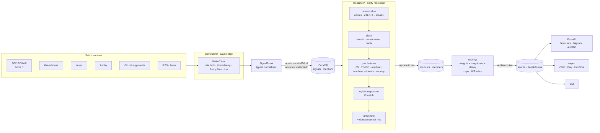

# signalgraph

**Account intelligence from public buying signals.** signalgraph pulls funding filings, job
postings, engineering activity and news from public APIs. It resolves the messy company names in
those feeds into one canonical account per company and ranks the accounts with a score that
explains itself line by line.

> Python 3.11 · async httpx · DuckDB · FastAPI · numpy · hypothesis · ruff + mypy --strict clean ·
> 166 tests (164 offline + 2 opt-in live)

---

## 1. The problem

Outbound teams already know the best time to reach a company: right after it raises money, starts
hiring its first sales team, or ships a big release. That information is public. It is also spread
across sources that disagree about **who** the company is:

| Source | How the same company shows up |
|---|---|
| SEC Form D | `NORTHWIND ROBOTICS INC`, no website |
| Greenhouse | `Northwind Robotics`, `northwindrobotics.com/careers?gh_jid=…` |
| GitHub | `northwind-robotics` |
| A news feed | `Northwind Robotcs` (typo) |
| A teammate's watchlist | `Acornfield Labs`, a name the company dropped last year |

Many "signal" setups are a Clay table plus an n8n flow that joins these records on an exact name
or domain match. That join has two problems. It misses real matches: typos, rebrands, `Inc` vs
`Incorporated`, legal names with no website. It also creates false ones: `Northwind Robotics
GmbH` (the German subsidiary, with its own `.de` domain) is merged into the US parent, the US
and Indian "Summit Solutions" become one company, and two startups that list their incubator's
URL get merged with the incubator and with each other. On the gold set below, that naive join reaches
**F1 0.784**. Every miss is a lost touchpoint, and every false merge sends a rep to the wrong company.

## 2. What I built

1. **Connectors** for SEC EDGAR Form D, Greenhouse, Lever, Ashby, GitHub org events and RSS/Atom.
   They are async and polite: per-host rate limits, retries with full jitter, `Retry-After`
   support, and a contact User-Agent. Each one normalises into a typed `SignalEvent`.
2. **An entity-resolution engine** built from canonicalisation, blocking, a learned pair scorer
   and constrained union-find. It reaches **P 0.974 / R 0.974 / F1 0.974** on a hand-labelled set
   of 173 tricky records (§4).
3. **Explainable scoring.** Each signal type has a weight and an exponential half-life, magnitude
   is log-scaled, and each type has a cap. ICP filters live in YAML. `GET /accounts/{id}/explain`
   returns every term of the score.
4. **Incremental, idempotent storage** in DuckDB. Each connector has a watermark and every upsert
   is keyed on a deterministic id, so running a step twice adds nothing (there is a test for it).
5. **Interfaces:** a CLI (`signalgraph ingest|resolve|score|export|serve|runs`), a read-only
   FastAPI service, and exports to CSV, Clay webhook rows and HubSpot batch-upsert JSON.

## 3. Architecture



The layers depend inward only. `domain/` holds pure models and has no I/O.
`connectors/`, `resolution/` and `scoring/` depend on `domain/`. `storage/` is the only module
that writes SQL. `services/` orchestrates the steps, and `api/` and `cli.py` are thin adapters.
Three ADRs in [`docs/adr/`](docs/adr) record the main decisions: the store, the ER design, and
the scoring model.

## 4. Entity resolution deep-dive

### Pipeline

| Stage | What it does | Why |
|---|---|---|
| **Name canonicalisation** | NFKC + casefold, strip accents, `&`/`+` → `and`, drop name-TLDs (`Orbitly.io`), collapse dotted abbreviations (`S.A.`, `K.K.`, `L.L.C.`), strip trailing legal forms in 15+ jurisdictions (`GmbH`, `Pvt Ltd`, `s.r.o.`, `Kabushiki Kaisha`…), extract `f/k/a` / `formerly` / `d/b/a` aliases | `Zentro Inc. (f/k/a Acornfield Labs, Inc.)` → `zentro` + alias `acornfield labs` |
| **Domain canonicalisation** | eTLD+1 via the Public Suffix List **including the private section**; unwrap Google/Facebook/LinkedIn/Outlook redirect URLs; emails → domain; IDN → punycode; free-mail, ATS and social hosts → *unknown*; tenant subdomains on Substack, Webflow and similar hosts are kept | `latticebloom.github.io` ≠ `pinehollow.github.io`, and `boards.greenhouse.io/x` says nothing about company x |
| **Blocking** | Candidate pair if two records share the canonical domain, the **rarest** name token (by document frequency in the batch), or a 4-char prefix. Oversized name blocks are skipped *and counted* | Avoids O(n²): 50k records need 0.024% of all pairs |
| **Features** (9) | Jaro-Winkler, token-set TF-IDF cosine, token containment, **residual similarity** (JW of the non-shared tokens), **number mismatch** (`Fund II` vs `Fund III`), domain match/mismatch, country match/mismatch. A missing value counts as neutral, not as disagreement | |
| **Scorer** | L2 logistic regression fitted with IRLS in numpy. Fellegi-Sunter is implemented as a baseline and compared | Weights ship as a 1 KB readable JSON file ([`er_model.json`](src/signalgraph/resolution/er_model.json)) |
| **Clustering** | Union-find over edges, strongest first, with a **cannot-link** constraint: two clusters holding different canonical domains are never merged | Stops chaining through domain-less SEC records |

### Evaluation protocol

- **Gold set:** [`data/gold/companies_gold.csv`](data/gold/companies_gold.csv) has
  **173 hand-labelled FICTIONAL records**, 70 entities and 156 true co-referent pairs. Each row
  carries a note naming its trap: subsidiaries with their own ccTLD (separate account), a rebrand
  shown only through `f/k/a`, `Inc` vs `Incorporated`, `Helio & Co` vs `Helio & Company Limited`,
  umlaut transliteration, shared `github.io`/`substack.com` hosts, ATS URLs used as the "domain",
  Google redirect URLs, an incubator domain listed by two portfolio startups, numbered fund series,
  and one generic name used by three different companies.
- **Training data is synthetic only** ([`synth.py`](src/signalgraph/resolution/synth.py), seed 13,
  6,891 records). It never sees the gold set.
- **The operating threshold is chosen on a separate synthetic validation set** (seed 99, 3,605
  records). The selected value, **0.40**, is then applied to the gold set unchanged. The gold set
  is not used for tuning.
- **Metrics are pairwise over all record pairs.** True pairs that blocking never proposed count as
  false negatives, so blocking recall is part of the reported recall.

### Results (gold set, measured by `make eval` → [`reports/er_eval.json`](reports/er_eval.json))

| Method @ threshold 0.40 | Precision | Recall | **F1** | TP / FP / FN |
|---|---|---|---|---|
| Baseline: exact normalised name OR same domain | 0.800 | 0.769 | 0.784 | 120 / 30 / 36 |
| Fellegi-Sunter + constrained union-find | 0.930 | 0.942 | 0.936 | 147 / 11 / 9 |
| Logistic regression, pairwise decisions only | 0.897 | 0.897 | 0.897 | 140 / 16 / 16 |
| Logistic regression + plain transitive closure | 0.784 | 0.974 | 0.869 | 152 / 42 / 4 |
| **Logistic regression + constrained union-find (shipped)** | **0.974** | **0.974** | **0.974** | **152 / 4 / 4** |

- **Blocking on the gold set:** 292 candidate pairs out of 14,878 (98.0% reduction), keeping
  96.8% of the true pairs. Transitive closure recovers most of the rest.
- **Best threshold:** a full sweep from 0.05 to 0.95 on the gold set peaks at F1 0.974 at 0.45,
  the same F1 as the threshold picked blind on synthetic data. The optimum is flat, so the
  validation-chosen threshold costs nothing here.
- **The cannot-link constraint matters more than the model choice.** It raises precision from
  0.784 to 0.974 at equal recall.

**The 8 remaining errors (worth reading):**

- 4 FP: `Ember & Oak Ventures Fund I, L.P.` merged with `Ember & Oak Ventures`. A fund vehicle
  and its manager share every token, and neither record has a domain.
- 2 FN: `NimbusGrid Energy` vs `Nimbus Grid Energy` (squashed tokens, no domain on one side).
- 1 FN: `Halcyon Tx` vs `Halcyon Biotherapeutics`. This would need a ticker or abbreviation
  dictionary.
- 1 FN: a startup whose only listed domain is its incubator's (`hatchery.vc/portfolio/…`). The
  cannot-link constraint correctly refuses the merge. Known limitation.

**Honesty notes:** two features, *residual similarity* and *number mismatch*, were added after
error analysis: the first came from a gold-set failure and the second from a live-run failure
(§7). Six numbered-series records were added to the gold set at the same time. The gold set
therefore influenced feature design, though not training or threshold choice. Synthetic-label
quality at scale is lower (F1 ≈ 0.90, see §6) because the generator injects heavier noise than
the gold set has.

## 5. Scoring model

```
points(signal) = base_weight[type] × subtype_weight × magnitude_factor × 0.5^(age_days / half_life[type])
score          = 100 × (1 − exp(−Σ capped_points_by_type / 40))
```

| Type | Half-life | Base | Subtype weights (excerpt) | Magnitude | Cap |
|---|---|---|---|---|---|
| funding (Form D) | 90 d | 25 | operating co 1.0, **pooled fund 0.0**, amendments ×0.5 | log10 USD (1M → 1×, 10M → 2×, max 3×) | – |
| hiring | 30 d | 3 | **gtm 2.0**, data 1.5, leadership 1.5, eng 1.0, ops 0.3 | – | 30 |
| news | 45 d | 6 | funding 2.0, leadership/expansion 1.5, launch 1.0 | – | – |
| eng_activity | 14 d | 1 | new public repo 3.0, release 2.0, push 0.5 | log1p(count) | 12 |

Everything lives in [`config/scoring.yaml`](config/scoring.yaml). ICP rules in
[`config/icp.yaml`](config/icp.yaml) (countries, excluded subtypes, name patterns such as
`Fund II`, minimum signals) **never change the score**. They set `icp_fit` and give a reason
for each failed rule.

Example from the offline demo (`GET /accounts/{id}/explain`, fictional company, scored as of
2026-11-19). The contributions always sum exactly to `raw_points`:

| Signal | Age | Base × subtype | Magnitude | Decay | Points |
|---|---|---|---|---|---|
| Form D, $12M sold | 7.0 d | 25 | 2.079 | 0.948 | 49.25 |
| News: "…raises $12M Series A…" | 6.4 d | 12 | 1.0 | 0.906 | 10.87 |
| News: "…appoints first Chief Revenue Officer" | 15.4 d | 9 | 1.0 | 0.789 | 7.10 |
| Hiring: Enterprise Account Executive (gtm) | 4.4 d | 6 | 1.0 | 0.903 | 5.42 |
| … 13 more | | | | | |
| **Northwind Robotics: raw 96.51 → score 91.04** | | | | | |

## 6. Quickstart

```bash
make install         # python3.11 venv + dev extras
make check           # ruff + mypy --strict + pytest
make demo            # offline: replays recorded fixtures (FICTIONAL companies) end to end
make serve           # FastAPI on :8000 over the demo DB -> /docs
```

Or step by step:

```bash
signalgraph --db demo.duckdb ingest --fixtures fixtures --today 2026-11-19   # 35 signals
signalgraph --db demo.duckdb ingest --fixtures fixtures --today 2026-11-19   # inserted: 0
signalgraph --db demo.duckdb resolve                                         # 15 mentions -> 8 accounts
signalgraph --db demo.duckdb score --as-of 2026-11-19T00:00:00+00:00
signalgraph --db demo.duckdb export --format csv            # or clay | hubspot, --icp-only, --out
signalgraph --db live.duckdb ingest                         # live: uses config/watchlist.yaml
```

Demo output (real run, fictional data):

```
name                           domain                 score  icp_fit  n_signals
Northwind Robotics             northwindrobotics.com  91.04  True     17   # GH + GitHub + RSS + Form D under its legal name
Halcyon Biosciences            halcyonbio.com         80.13  True     4    # "HALCYON BIO, INC." (SEC, no domain) joined
Zentro                         zentro.ai              73.20  True     4    # Ashby + Lever board filed under old name + SEC f/k/a
BluePeak Health                bluepeakhealth.com     42.00  True     3    # "Blue Peak Health Inc" Form D/A (amendment x0.5)
Kestrel Data, Inc.             kestreldata.com        21.20  True     2    # kept apart from ...
Hyperion Vale Inc              hyperionvale.com       20.25  True     2    # domain came wrapped in a Google redirect URL
Kestrel Data Systems Pvt. Ltd. kestreldata.in         15.12  True     2    # ... the Indian company with the same name stem
Ember & Oak Ventures Fund I    -                       0.00  False    1    # pooled fund: weight 0, fails ICP name rule
```

API: `GET /health`, `GET /accounts?icp_only=&min_score=&limit=&offset=`, `GET /accounts/{id}`,
`GET /accounts/{id}/explain`, `GET /signals?signal_type=`. Configuration lives in
[`.env.example`](.env.example); no secrets are needed. `GITHUB_TOKEN` is optional.

**Exports.** `clay` writes flat JSON rows for a Clay webhook table. `hubspot` writes
`POST /crm/v3/objects/companies/batch/upsert` bodies in chunks of 100, keyed on a unique
custom property `signalgraph_account_id`, so re-exporting updates records instead of creating
duplicates.

## 7. Benchmarks (measured)

`make bench` runs the full production resolver end to end (normalise → block → score → cluster →
build accounts) on **synthetic** records. It does 3 repeats with caches cleared before each one
and reports the median. Machine: the 2-vCPU x86_64 Linux sandbox this was built in, Python
3.11.18, single process ([`reports/benchmark.json`](reports/benchmark.json)).

| Records | Median wall | **Records / s** | Candidate pairs (of all pairs) | Stage split (normalise / block / score / cluster) | Pairwise F1 vs synthetic labels |
|---|---|---|---|---|---|
| 10,000 | 2.35 s | **4,250** | 59,368 of 49,995,000 (0.12%) | 0.38 / 0.11 / 1.48 / 0.36 s | 0.907 |
| 50,000 | 12.38 s | **4,038** | 300,868 of 1,249,975,000 (0.024%) | 2.38 / 0.81 / 7.28 / 1.81 s | 0.896 |

Throughput stays almost flat from 10k to 50k records, which is what blocking is for: the number
of candidate pairs grows about linearly with the record count, not quadratically. Pair scoring
in pure Python accounts for about 60% of the time. Jaro-Winkler is memoised on ordered name pairs
(symmetry is property-tested), because the 10k run has only 26k distinct name pairs among its
59k candidates. Individual runs on this shared machine varied from 10.8 to 15.3 s at 50k.

## 8. Live data (what actually ran)

On **2026-11-19, about 07:52 UTC**, from this sandbox, I ran the live connectors.
[`reports/live_run_2026-11-19.json`](reports/live_run_2026-11-19.json) holds the counts; no raw
data is committed.

| What | Result |
|---|---|
| `pytest tests/live` (`SIGNALGRAPH_LIVE=1`) | 2 passed: EDGAR Form D and Greenhouse |
| Ingest #1 (EDGAR, 3-day lookback capped at 25 filings, plus Greenhouse board `stripe`) | **809 signals**: 784 Stripe postings and 25 Form D filings, in 19.9 s. One transient `ConnectError` on `www.sec.gov` was retried successfully |
| Ingest #2 (same config) | **0 inserted**. Both connectors started from their stored watermarks (8.8 s) |
| Role families across Stripe's 784 postings | gtm 267 · eng 195 · other 110 · ops 70 · product 56 · data 51 · security 20 · leadership 15 |
| Form D split | 17 operating companies, 8 pooled investment funds (tagged `form_d_fund`, weight 0). Median amount for operating companies: $1.6M |
| Scoring | 26 accounts, 17 ICP-fit; Stripe's hiring contribution hit its cap of 30 points |

**What the live run caught:** the first resolve turned 26 mentions into **20 accounts**. Every one
of those 6 merges was wrong. Blocking had produced only 18 candidate pairs, and all of them were
between numbered series vehicles from two sponsors (`<Sponsor> Partners 16/18/19 LLC`,
`<Sponsor> Ventures I…VI – Series …`). The fix was to add the `number_mismatch` feature, add
numbered-series hard negatives to the synthetic generator, and add 6 numbered-series records to
the gold set, then retrain and re-evaluate. Re-resolving the same 26 mentions gave **26
accounts**.

Not run live: GitHub (the sandbox egress proxy blocks `/orgs/{org}/events`), Lever, Ashby and RSS.
These four are covered by fixture tests only.

## 9. Limitations and trade-offs

- **Domain cannot-link vs rebrands.** A rebrand whose old *and* new domains both appear stays
  split unless an `f/k/a` alias or a shared domain bridges it. I chose the precision win
  (+0.19 on the gold set) over that recall.
- **Fund vehicles vs managers** (`… Fund I, L.P.` vs `… Ventures`) still merge when neither side
  has a domain. The ICP name rule catches them for routing, but the graph is wrong.
- **Shared incubator domains**: a portfolio company that lists only `incubator.vc/portfolio/x` is
  treated as the incubator's domain.
- **Full re-resolve each run.** This is fine at 50k mentions (12 s), but it is not incremental
  (see roadmap). Account ids are keyed on domain, so they stay stable as clusters grow.
- **Scoring weights are expert priors**, not fitted to outcomes. There is no CRM outcome data in
  this project, and I chose not to invent any.
- **Form D lists no website**, so SEC-only accounts depend on name matching. The 3-day EDGAR
  lookback with a 25-filing cap is a politeness default, not a coverage claim.
- **Single writer.** DuckDB handles one batch writer; the API is read-only (one cursor per request).

## 10. Roadmap

1. Incremental ER: re-score only blocks touched by new mentions, and keep cluster history so
   splits and merges are auditable.
2. Active learning: queue the pairs closest to the threshold for human review and feed the
   labels back into training.
3. Learn the scoring weights from closed-won / closed-lost CRM outcomes once they exist, with the
   current weights as the baseline to beat.
4. Website enrichment for SEC-only accounts (domain discovery) to lift recall on Form D.
5. A Rust/`rapidfuzz` similarity backend behind the same interface; pair scoring is about 60% of
   ER time.
6. Scheduled runs (GitHub Actions cron) that post webhooks for newly ICP-fit accounts.

## Repository layout

```
src/signalgraph/
  domain/        models.py (SignalEvent, Account, ScoreBreakdown), taxonomy.py (role/news classifiers)
  connectors/    http.py (PoliteClient), edgar.py, jobs.py (Greenhouse/Lever/Ashby), github.py, rss.py, base.py
  resolution/    names.py, domains.py, features.py, blocking.py, scorers.py, cluster.py, engine.py,
                 synth.py, evaluate.py, er_model.json
  scoring/       config.py (typed YAML), engine.py
  storage/       schema.sql, repository.py (the only SQL)
  services/      pipeline.py (ingest/resolve/score), export.py (CSV/Clay/HubSpot)
  api/app.py     FastAPI        cli.py   click CLI
config/          scoring.yaml, icp.yaml, watchlist.yaml (live)
fixtures/        recorded API responses for FICTIONAL companies + manifest + demo watchlist
data/gold/       hand-labelled ER gold set (FICTIONAL)
scripts/         train_er.py, eval_er.py, bench_er.py
reports/         er_eval.json, benchmark.json, live_run_2026-11-19.json
tests/           unit/ integration/ property/ (hypothesis) live/ (opt-in)
docs/adr/        0001 DuckDB · 0002 ER design · 0003 scoring model
```

## Data and honesty

- Every company in `fixtures/` and `data/gold/` is fictional. The synthetic generator is labelled
  as such everywhere it is used.
- Every number in this README comes from a committed report or a run described above. There are
  no customer results, because there are no customers yet.

MIT licensed. Built by Hussain Singapuri.
